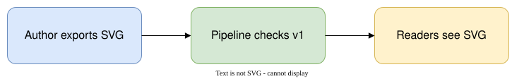

# Diagram export review

This isolated review page demonstrates the documentation pipeline's diagram export check.

The editable source is committed beside its exported SVG. The author exports the image before publishing; the pipeline checks the committed history and does not render it automatically.
