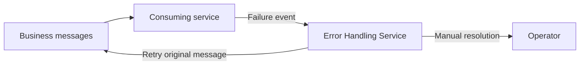

# Error Handling

## Purpose

A failed message must remain recoverable: losing it can leave a distributed business process incomplete.
Error handling separates normal message consumption from recovery, so other messages can continue to be
processed while a failure is investigated or retried.

## How it works

The jEAP Messaging error handler reports a failed message to the Error Handling Service (EHS). The EHS
stores the failure and retries temporary errors. Persistent failures can be escalated to a manual task;
operators inspect, retry or close them through the UI. Error groups bring recurring failures together,
and operator actions are audited.

## Documentation

- [Service documentation](https://jeap-admin-ch.github.io/docs/building-blocks/reusable-microservices/jeap-error-handling/)
- [Getting started](https://jeap-admin-ch.github.io/docs/building-blocks/reusable-microservices/jeap-error-handling/getting-started)
