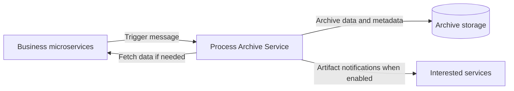

# Process Archive Service

## Purpose

The Process Archive Service (PAS) archives business data for traceability.

## How it works

A message triggers archiving:
the data is either included in the message or fetched from the responsible service through a REST API.
The PAS stores the data and its identifying metadata as an archived artifact in an S3-compatible store.

Archive types describe the data format and retention requirements. Versioning, retention and object
lock protect archived versions. PCS snapshots are one possible kind of archived data; the archive-reader
library supports retrieving artifacts later.

## Documentation

- [Service documentation](https://jeap-admin-ch.github.io/docs/building-blocks/reusable-microservices/jeap-process-archive-service/)
- [Getting started](https://jeap-admin-ch.github.io/docs/building-blocks/reusable-microservices/jeap-process-archive-service/getting-started)
