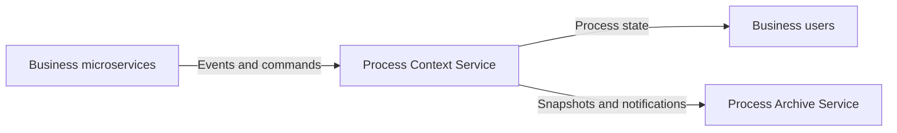

# Process Context Service

## Purpose

The Process Context Service (PCS) makes distributed business processes observable.

## How it works

It collects messages from participating microservices and shows the state of each process and its tasks. A process template
defines how the messages are interpreted. The business services decide and execute their own work;
the PCS observes the process without orchestrating it.

The live process view helps users understand what has happened and investigate incomplete processes.
Snapshots capture a process state for long-term archiving by the PAS.

## Documentation

- [Service documentation](https://jeap-admin-ch.github.io/docs/building-blocks/reusable-microservices/jeap-process-context-service/)
- [Getting started](https://jeap-admin-ch.github.io/docs/building-blocks/reusable-microservices/jeap-process-context-service/getting-started)
