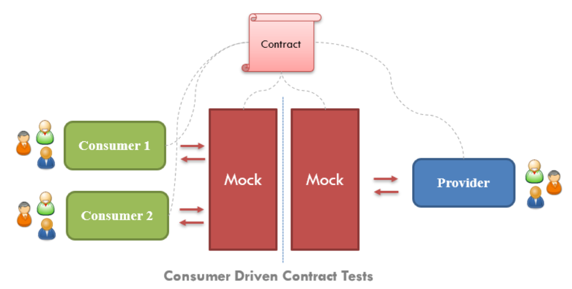
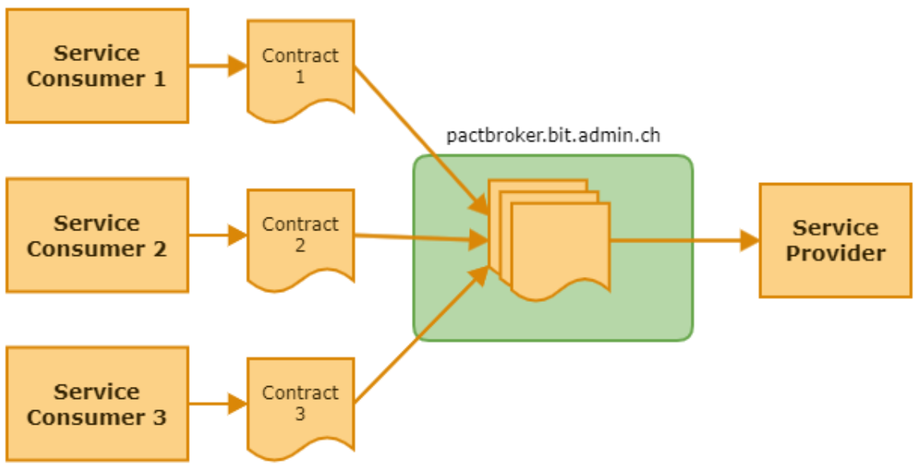
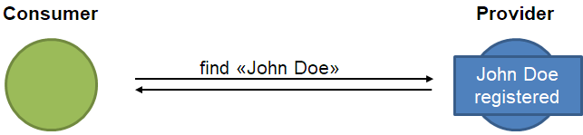

# Consumer-Driven Contract Tests

## Motivation

The goal of Consumer-Driven Contract Tests (CDCT) with Pact is to achieve efficient, stable and meaningful integration tests between a service provider and its service consumers. Such tests should make the usually very complex, fragile and interdependent E2E tests on test environments with preconfigured test data as superfluous as possible.

With these tests, it is possible to automatically ask the question "can-I-deploy?", which allows us to continuously deploy to production.

:::info
The Pact framework describes the testing of HTTP interfaces and messages. We only use Pact for testing HTTP interfaces. We test the compatibility of messages with our own concept → see [can-I-Deploy für Messaging](../../messaging/message-contracts/can-i-deploy-for-messaging.md)
:::

## Read the basics

There are enough good explanations about Consumer-Driven Contract Tests (CDCT). Take your time and study the following resources:

- [What is Pact contract testing & how does it work? | PactFlow](https://pactflow.io/how-pact-works/?utm_source=ossdocs&utm_campaign=getting_started#slide-1)
- [Introduction | Pact Docs](https://docs.pact.io/)
- Checkout our example 
  - [jme-cdct-consumer-example](https://github.com/jme-admin-ch/jme-cdct-consumer-example)
  - [jme-cdct-provider-example](https://github.com/jme-admin-ch/jme-cdct-provider-example)

### The Big Picture

Image source: [Consumer Driven Contract (CDC) Tests - Testautomatisierung.org](https://www.testautomatisierung.org/lexikon/consumer-driven-contract-cdc-tests/)

### Contract = Pact = json-File

A **contract** between a **consumer** and **provider** is called a **_pact_**. Each pact is a collection of **_interactions_**. Each interaction describes:

- An expected request - describing what the consumer is expected to send to the provider
- A minimal expected response - describing the parts of the response the consumer wants the provider to return.

At the end a json-file is generated and will be uploaded to the Pact Broker.

Pact is *consumer-driven* contract testing, i.e. the pacts are specified by the consumers, but they do it in *collaboration* with the provider.

### Pact Broker

This is the place where all the pacts (aka contracts) will be uploaded.

### Consumer and Provider Mocks

Based on a contract, Pact can provide a mock provider for consumer tests and replay the pact's requests against the real provider during provider verification. This allows consumers and providers to be tested independently.

### Provider States

With a provider state, a consumer can define a condition under which a certain interaction takes place, e.g. if a consumer expects a provider to respond to a 'find' request for 'John Doe' with John Doe's data, the interaction would have to take place under the condition that 'John Doe' has been registered with the provider, i.e. the provider state "John Doe registered".

## Create Consumer Tests

**See [How to: write a Pact consumer test](../../../how-tos/testing/write-a-pact-consumer-test.md)**
for the Maven setup, the consumer test class, the Pact interaction methods and the test method itself.

### Test Scope

Consumer Pact tests should focus on ensuring that the request creation and response handling are correct. Usually, only the part of the consumer that interacts directly with the external service needs to be tested (highlighted in yellow below).

## Create Provider Tests

**See [How to: write a Pact provider test](../../../how-tos/testing/write-a-pact-provider-test.md)**
for the Maven setup, the provider test class, the pact-verification test method and the provider state methods.

### Test Scope

A provider pact test must check that the provider responds to consumer requests as specified in the consumer pacts. Generally, the entire part of the provider that is involved in processing the request must be tested, in particular the part that defines the structure of the response data. Other parts, in particular access to external systems, can usually be mocked.

## Webhooks on the Pact Broker

### Why Webhooks?

1. The consumers upload their pacts (contract files) to the Pact Broker (during the build).
2. When the provider is built, it downloads the pacts and verifies itself against all the pacts.

What happens when a consumer uploads a new or a modified contract? Without a new provider build the new contract will not be verified.

This is where Pact Broker webhooks come in: the Pact Broker knows that there is a new or changed pact and which provider has to verify the new pact. With a webhook, the Pact Broker can notify the provider to run its provider tests on the new pact.

## Can-I-Deploy

:::info
can-i-deploy is the main reason why we do Consumer-Driven Contract Tests.
:::

Pact provides a CLI tool called [can-i-deploy](https://docs.pact.io/pact_broker/can_i_deploy), which can be used to check the compatibility of consumer and provider versions in environments. Specifically, before deploying a consumer or provider to an environment, it can be queried on the Pact Broker whether the version of the consumer or provider to be deployed is compatible with the consumer or provider versions already deployed in the environment. This means that can-i-deploy queries in the deployment pipeline can be used to ensure that only compatible services are deployed in an environment.

## Topics

- [jEAP Pact Integration Details](jeap-pact-integration-details.md)
