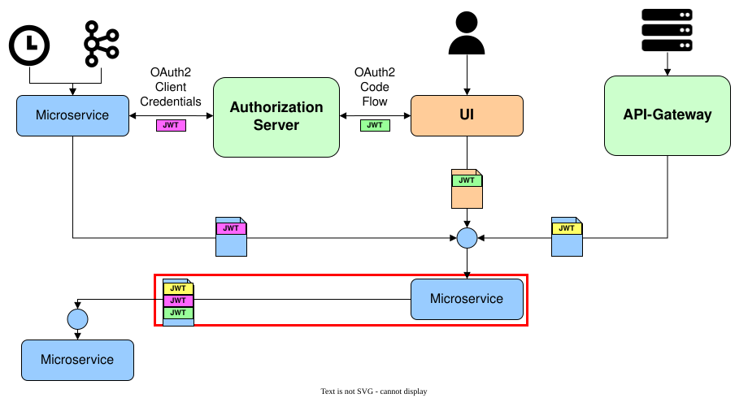

# How to: call a secured REST API from Java

A microservice calls a REST API protected with OAuth2 either with its own access token (system context)
or with a token it has itself received from a caller (token propagation). The
`jeap-spring-boot-security-client-starter` provides a `RestClient` builder factory for both cases — see
[OIDC in the Blueprint Microservice](../../concepts/authentication-and-authorization/oidc-in-the-blueprint-microservice.md) for the underlying OAuth2 flows.

## Steps

1. Add the `jeap-spring-boot-security-client-starter` dependency (it is also pulled in automatically by
   `jeap-spring-boot-security-starter`):

   ```xml
   <dependency>
       <groupId>ch.admin.bit.jeap</groupId>
       <artifactId>jeap-spring-boot-security-client-starter</artifactId>
   </dependency>
   ```

2. Configure an OAuth2 client for the authorization server the target API's access is managed by — see the
   [configuration property reference](../../concepts/authentication-and-authorization/calling-secured-rest-apis-from-java.md#configuration)
   in the concept page. An authorization server must be available, e.g.
   [Keycloak](../../concepts/authentication-and-authorization/authorization-servers/keycloak.md) or the
   [OAuth2 mock server](../../concepts/authentication-and-authorization/testing/oauth2-mock-server.md).

3. Create a `RestClient` with the `JeapOAuth2RestClientBuilderFactory`, then configure it further as needed
   (e.g. a base URL) before building the client instance:

   ```java
   RestClient.Builder oAuth2RestClientBuilder = jeapOAuth2RestClientBuilderFactory.createForClientId("default");
   RestClient oAuth2RestClient = oAuth2RestClientBuilder.baseUrl(url).build();
   ```

   Pick the factory method matching your use case (own token, propagated token, or a preference for a
   propagated token falling back to the service's own token) — see the
   [factory-method reference](../../concepts/authentication-and-authorization/calling-secured-rest-apis-from-java.md#creating-a-client-instance)
   in the concept page.

## Example: calling in the system context

An example project for authentication in the system context is available at [jme-security-client-service](https://github.com/jme-admin-ch/jme-security-example/tree/main/jme-security-client-service). The project
implements an unprotected REST API that simply delegates incoming requests to the protected REST API of the corresponding
resource examples (see [Authentication and authorization for REST APIs](../../concepts/authentication-and-authorization/protecting-rest-apis/rest-api-authentication-and-authorization.md#examples)). The example contains the following components:

- **PartnerController:** Calls the OAuth2-protected REST endpoint of the resource example. It uses a RestClient instance created with the JeapOAuth2RestClientBuilderFactory. In a local deployment, it is reachable at [http://localhost:8090/jme-security-client-service/api/partners](http://localhost:8090/jme-security-client-service/api/partners).
- **InfoController:** Calls the REST endpoint of the resource example that is protected with basic authentication. It uses a RestClient instance created with the standard RestClient builder. In a local deployment, it is reachable at [http://localhost:8090/jme-security-client-service/api/info](http://localhost:8090/jme-security-client-service/api/info).
- **OtherSystemController:** Calls the OAuth2-protected REST endpoint using a second authorization server at [http://localhost:8280](http://localhost:8280). This simulates calling a service of another business application. It uses a RestClient instance created with the JeapOAuth2RestClientBuilderFactory *with a different client ID* ("jeap-microservice-examples-oauth-client-other-system"). In a local deployment, it is reachable at [http://localhost:8090/jme-security-client-service/api/othersystem](http://localhost:8090/jme-security-client-service/api/othersystem).

The example requires an authorization server with a matching configuration. Locally and in the DEV environment, an instance of the [OAuth2 mock server](../../concepts/authentication-and-authorization/testing/oauth2-mock-server.md) is used for this; other environments usually provide a [Keycloak](../../concepts/authentication-and-authorization/authorization-servers/keycloak.md) server. In general, the authorization server must be configured to issue tokens for the system context that contain the roles required to access the OAuth2-protected REST endpoints of the resource example projects (see [Authentication and authorization for REST APIs](../../concepts/authentication-and-authorization/protecting-rest-apis/rest-api-authentication-and-authorization.md#examples)).

## Example: token propagation

Token propagation describes the case where a microservice uses the access token it was called with to call another microservice. The second microservice is then accessed with the permissions of the access token received by the first microservice. Depending on the origin, this token may have been issued for different contexts. The figure below shows how access tokens from the system, user and B2B contexts can be used to call a microservice, and how this microservice can then use these tokens to access another microservice. The token propagation is marked with a red rectangle in the figure.



An example demonstrating authentication with token propagation is available: The example microservice [jme-security-clientresource-service](https://github.com/jme-admin-ch/jme-security-example/tree/main/jme-security-clientresource-service) acts both as an OAuth2 resource and as an OAuth2 client at the same time. As an OAuth2 resource, the example microservice supports the same API as the resource example from [Authentication and authorization for REST APIs](../../concepts/authentication-and-authorization/protecting-rest-apis/rest-api-authentication-and-authorization.md#examples). As an OAuth2 client, it can access this resource example. The example microservice runs locally on port 8082.

The idea is that the token propagation example projects can be placed transparently between a client for the system context (see above) and a resource from [Authentication and authorization for REST APIs](../../concepts/authentication-and-authorization/protecting-rest-apis/rest-api-authentication-and-authorization.md#examples). To this end, the token propagation example microservice forwards all requests of the client example microservice directly to the resource example microservice. In doing so, the token propagation example microservice uses differently configured client instances for different endpoints and thus demonstrates use cases for each of the three factory methods of the JeapOAuth2RestClientBuilderFactory, in particular also for token propagation.

To establish the call chain client example microservice → token propagation example microservice → resource example microservice, add the request parameter `target=clientresource` to the call of the client example microservice. Locally, for example, call [http://localhost:8090/jme-security-client-service/api/partners?target=clientresource](http://localhost:8090/jme-security-client-service/api/partners?target=clientresource) instead of [http://localhost:8090/jme-security-client-service/api/partners](http://localhost:8090/jme-security-client-service/api/partners). The client example microservice will then call the token propagation example microservice instead of the resource example microservice.

## Related

- [Calling secured REST APIs from Java](../../concepts/authentication-and-authorization/calling-secured-rest-apis-from-java.md) — the configuration-property and factory-method reference this how-to builds on.
- [Authentication and authorization for REST APIs](../../concepts/authentication-and-authorization/protecting-rest-apis/rest-api-authentication-and-authorization.md) — protect the REST APIs that are called here.
- [Cross-platform authentication](../../concepts/authentication-and-authorization/authorization-servers/cross-platform-authentication.md) — token propagation across platforms.
- [How to: implement a custom claim set converter](implement-custom-claim-set-converter.md) — the resource side of accepting tokens from an authorization server that doesn't issue tokens in the expected format.
