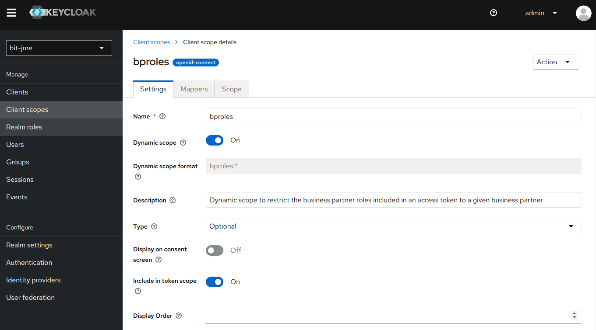
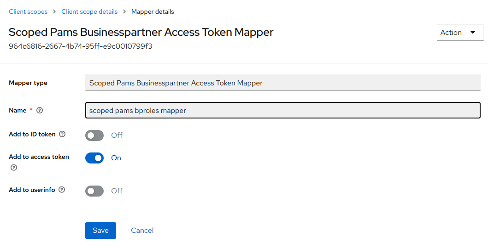
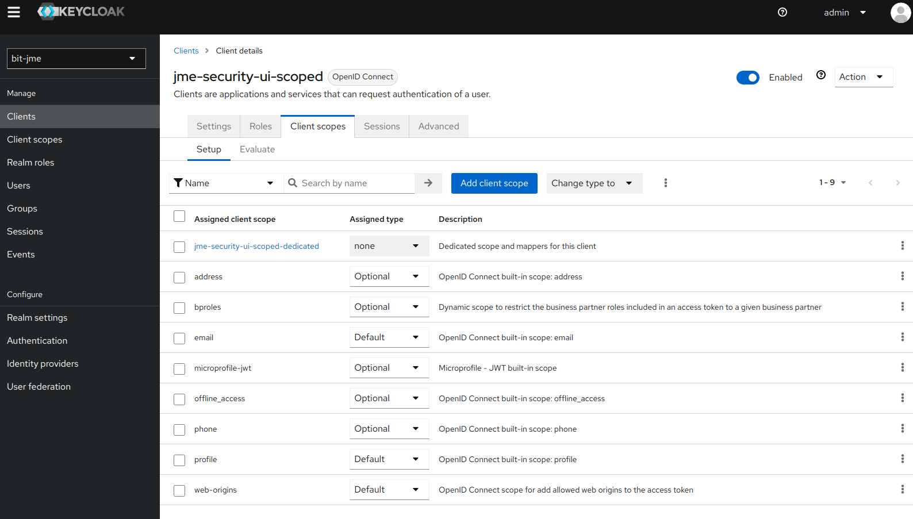

# How to: restrict business partner roles in a token with the dynamic scope `bproles`

The jEAP Keycloak plugin's "Scoped Businesspartner Access Token Mapper" restricts the business partner
roles included in an access token to a given business partner, via the dynamic Keycloak scope `bproles`.
This keeps the token small for a user authorized for many business partners but working for one at a
time.

## Steps

1. Enable the (currently experimental) Keycloak feature "dynamic scopes" for the Keycloak instance running
   the jEAP Keycloak plugin, e.g. by starting Keycloak with the following option:

   ```text
   --features=dynamic-scopes
   ```

2. Configure the dynamic scope `bproles` in the realm. In the realm menu on the left side select "Client
   scopes" and then press the button "Create client scope" to add the scope "bproles" as an optional
   dynamic scope to the realm:

   

   Make sure "Include in token scope" is set to "on". In the tab "Mappers" of the newly created `bproles`
   scope, press the button "Add mapper" and select "By configuration" and then select the "Scoped
   Businesspartner Access Token Mapper" from the list. Name your mapper instance and activate it at least
   for "Add to access token".

   

3. Assign the `bproles` scope to the client. In the realm menu on the left side select "Clients" and then
   the tab "Client list". From the client list, select the client to be configured for using the dynamic
   `bproles` scope and select the tab "Client scopes". Make sure the `bproles` scope is listed under
   "Assigned client scopes" with "Assigned type" "Optional". If the `bproles` scope is missing, add it by
   clicking the "Add client scope" button.

   

4. Request a token restricted to one business partner by specifying the variable part of the dynamic scope
   as that partner's id. To request an access token that only contains the user's business partner roles
   for the partner with the id `123-abcd-987-ef`, the authentication request would have to specify (at
   least) the following authentication scope:

   ```text
   openid bproles:123-abcd-987-ef
   ```

   Additional scope parameters like `profile`, `address`, etc. can be provided as well in the usual way,
   i.e. by adding them to the space separated list.

   Alternatively, request a token with the roles of all the business partners a user has been authorized
   for by using "*" as the variable part of the scope. This could allow an application to first identify
   the partners a user is authorized for and let the user choose the partner to work for, then request a
   partner-specific token to actually carry out the work. Be aware that specifying "*" instead of a
   specific business partner id might result in a large access token.

   ```text
   openid bproles:*
   ```

   Or omit the `bproles` scope entirely to get a token without any business partner roles:

   ```text
   openid
   ```

If your Keycloak configuration contains other token mappers that also add business partner roles to a
token, they will be executed in addition to the "Scoped Businesspartner Access Token Mapper". If you only
want business partner roles from the "Scoped Businesspartner Access Token Mapper" in your tokens, make sure
no other mapper contributing business partner roles is active.

## Example

The [jEAP security example project](https://github.com/jme-admin-ch/jme-security-example)
gives examples for

- configuring the [jEAP OAuth2 mock server](../../concepts/authentication-and-authorization/testing/oauth2-mock-server.md#dynamic-scope-bproles) to support the dynamic scope
  `bproles`
- configuring Java clients to request an access token restricted to a certain business partner by specifying the
  corresponding `bproles` scope
- configuring a UI client to request an access token restricted to a certain business partner by specifying the
  corresponding `bproles` scope

For details, see the section "Restricting business partner roles in tokens using the dynamic scope 'bproles:*'" in
the project's [readme](https://github.com/jme-admin-ch/jme-security-example/blob/main/README.md).

## Related

- [Minimizing access token sizes](../../concepts/authentication-and-authorization/tokens/minimizing-access-token-sizes.md) — why access tokens get large and the other available size-reduction options.
- [How to: use lightweight access tokens](use-lightweight-access-tokens.md)
- [How to: prune roles from access tokens](prune-roles-from-access-tokens.md)
