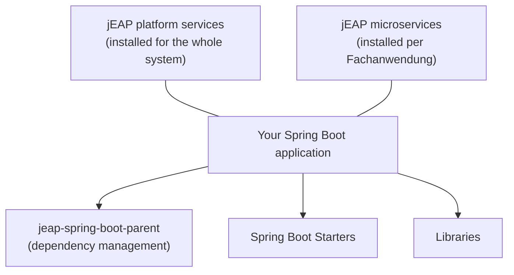

# What is jEAP?

**jEAP (Java Enterprise Application Platform)** is a suite of
[Spring Boot libraries](building-blocks/libraries/index.md),
[Spring Boot starters](building-blocks/spring-boot-starters/index.md) and
[reusable microservice templates](building-blocks/reusable-microservices/index.md)
for building Java-based enterprise applications. It is published as open source under the
[Apache License 2.0](https://github.com/jeap-admin-ch/jeap/blob/main/LICENSE) by the
Federal Office of Information Technology, Systems and Telecommunication (FOITT/BIT)
of the Swiss Confederation.

jEAP solves the recurring cross-functional concerns of enterprise applications —
messaging, security, persistence, observability, encryption, and more — once and in a
reusable way, so that application teams can focus on their business logic.

## Core principles

- **Convention over configuration.** Applications inherit a Maven parent that provides
  aligned dependency versions and sensible default configuration. See
  [Using jEAP](using-jeap/index.md).
- **Reuse cross-functional concerns.** Each concern
  ([logging](https://jeap-admin-ch.github.io/docs/building-blocks/spring-boot-starters/jeap-spring-boot-starters/jeap-spring-boot-logging-starter),
  [monitoring](https://jeap-admin-ch.github.io/docs/building-blocks/spring-boot-starters/jeap-spring-boot-starters/jeap-spring-boot-monitoring-starter),
  [messaging](https://jeap-admin-ch.github.io/docs/building-blocks/libraries/jeap-messaging/),
  [security](https://jeap-admin-ch.github.io/docs/building-blocks/spring-boot-starters/jeap-spring-boot-starters/jeap-spring-boot-security-starter), …)
  is solved in a dedicated, independently versioned library or starter.
- **Secure by default.**
  [OAuth2/OIDC resource-server security](https://jeap-admin-ch.github.io/docs/building-blocks/spring-boot-starters/jeap-spring-boot-starters/jeap-spring-boot-security-starter),
  [client-side encryption of data-at-rest](https://jeap-admin-ch.github.io/docs/building-blocks/libraries/jeap-crypto/),
  [TLS](https://jeap-admin-ch.github.io/docs/building-blocks/spring-boot-starters/jeap-spring-boot-tls-starter/), and
  [certificate-based AWS credentials](https://jeap-admin-ch.github.io/docs/building-blocks/spring-boot-starters/jeap-spring-boot-roles-anywhere-starter/)
  are provided out of the box.
- **Platform-agnostic core, cloud-native ready.** The jEAP core does not depend on a specific runtime
  platform, so business logic stays portable. Dedicated
  [starters](building-blocks/spring-boot-starters/index.md) add first-class support
  for running on Kubernetes/OpenShift and AWS —
  [configuration management](https://jeap-admin-ch.github.io/docs/building-blocks/spring-boot-starters/jeap-spring-boot-config-aws-starter/),
  [secrets management](https://jeap-admin-ch.github.io/docs/building-blocks/spring-boot-starters/jeap-spring-boot-starters/jeap-spring-boot-vault-starter),
  [object storage](https://jeap-admin-ch.github.io/docs/building-blocks/spring-boot-starters/jeap-spring-boot-starters/jeap-spring-boot-object-storage-starter),
  [TLS](https://jeap-admin-ch.github.io/docs/building-blocks/spring-boot-starters/jeap-spring-boot-tls-starter/), and more.
- **First-class support for event-driven architecture.** EDA is a first-class, well-supported
  capability in jEAP: [asynchronous messaging](https://jeap-admin-ch.github.io/docs/building-blocks/libraries/jeap-messaging/) is
  built on Apache Kafka and Avro, with reliable delivery via the
  [Transactional Outbox pattern](https://jeap-admin-ch.github.io/docs/building-blocks/libraries/jeap-messaging-outbox/) and ordered
  consumption using the [jEAP Sequential Inbox](https://jeap-admin-ch.github.io/docs/building-blocks/libraries/jeap-messaging-sequential-inbox/).

## Value proposition

See [Why jEAP?](why-jeap.md) for why you would want to
build on jEAP.

## Problems jEAP solves

| Concern                                                       | Provided by                                                                               |
|---------------------------------------------------------------|-------------------------------------------------------------------------------------------|
| Asynchronous messaging (Kafka/Avro)                           | [Libraries](building-blocks/libraries/index.md) — [jeap-messaging](https://jeap-admin-ch.github.io/docs/building-blocks/libraries/jeap-messaging/) |
| Reliable message delivery (Transactional Outbox)              | [jeap-messaging-outbox](https://jeap-admin-ch.github.io/docs/building-blocks/libraries/jeap-messaging-outbox/)      |
| Ordered message processing                                    | [jeap-messaging-sequential-inbox](https://jeap-admin-ch.github.io/docs/building-blocks/libraries/jeap-messaging-sequential-inbox/) |
| Audit records                                                 | [jeap-audit](https://jeap-admin-ch.github.io/docs/building-blocks/libraries/jeap-audit/)                            |
| Client-side encryption of data-at-rest                        | [jeap-crypto](https://jeap-admin-ch.github.io/docs/building-blocks/libraries/jeap-crypto/)                          |
| Transparent JWE encryption of HTTP API payloads               | [jeap-spring-boot-jwe-starter](https://jeap-admin-ch.github.io/docs/building-blocks/spring-boot-starters/jeap-spring-boot-jwe-starter/) |
| Certificate-based AWS credentials (IAM Roles Anywhere)        | [jeap-spring-boot-roles-anywhere-starter](https://jeap-admin-ch.github.io/docs/building-blocks/spring-boot-starters/jeap-spring-boot-roles-anywhere-starter/) |
| Real-time server→client events (SSE)                          | [jeap-server-sent-events](https://jeap-admin-ch.github.io/docs/building-blocks/libraries/jeap-server-sent-events/)  |
| Search / OpenSearch indexing & querying                       | [jeap-opensearch-* building blocks](building-blocks/libraries/index.md)                   |
| Application setup, logging, monitoring, security, persistence | [Spring Boot Starters](building-blocks/spring-boot-starters/index.md)                           |
| Secrets, DB migration & pooling, object storage, TLS          | [Spring Boot Starters](building-blocks/spring-boot-starters/index.md)                     |
| Error handling of faulty messages                             | [Reusable Microservices](building-blocks/reusable-microservices/index.md) — jeap-error-handling |
| Message exchange with external parties (HTTP messagebox)      | jeap-message-exchange-service                                                             |
| Process context & process archive                             | jeap-process-context-service, [jeap-process-archive-service](https://jeap-admin-ch.github.io/docs/building-blocks/reusable-microservices/jeap-process-archive-service/) |
| Architecture inventory & deployment logging                   | jeap-archrepo-service, jeap-deploymentlog-service                                         |
| Policy compliance & governance checks                         | jeap-governance-service                                                                   |
| DB schema publishing to the architecture repository           | [jeap-db-schema-publisher](https://jeap-admin-ch.github.io/docs/building-blocks/libraries/jeap-db-schema-publisher/) |
| Message contracts & business-process tests                    | jeap-message-contract-service, jeap-bptest-orchestrator                                   |
| OAuth2/OIDC mock for local development & testing              | jeap-oauth-mock-server                                                                    |
| Project bootstrapping & codebase generation                   | jeap-initializer                                                                          |
| Developer tooling, registries, Maven plugins                  | [Tooling & Registries](building-blocks/tooling/index.md)                                        |

## Next steps

- [Using jEAP](using-jeap/index.md) — the parent POMs and dependency management.
- [App Building Blocks](building-blocks/index.md) — the [libraries](building-blocks/libraries/index.md),
  [starters](building-blocks/spring-boot-starters/index.md) and
  [microservices](building-blocks/reusable-microservices/index.md) you compose from.
